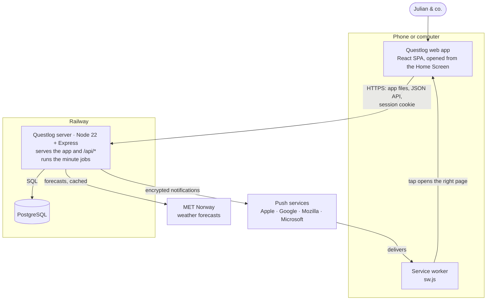
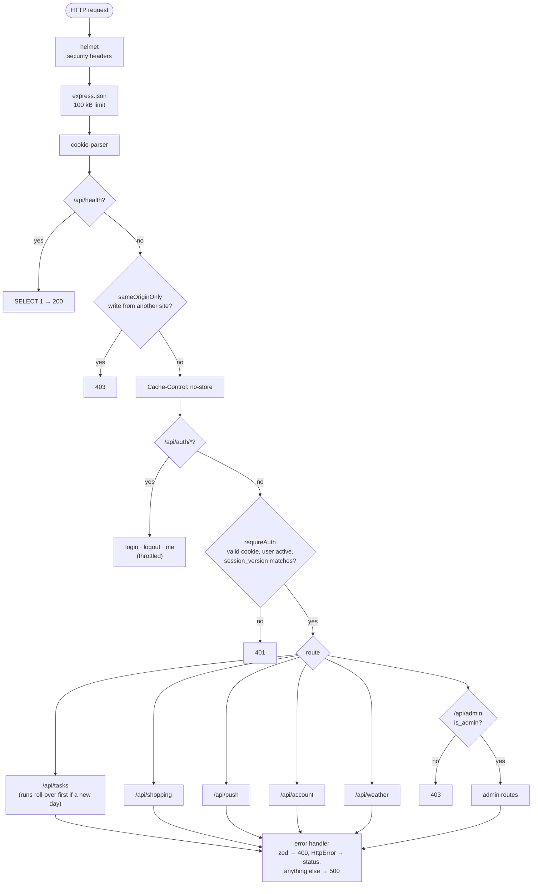
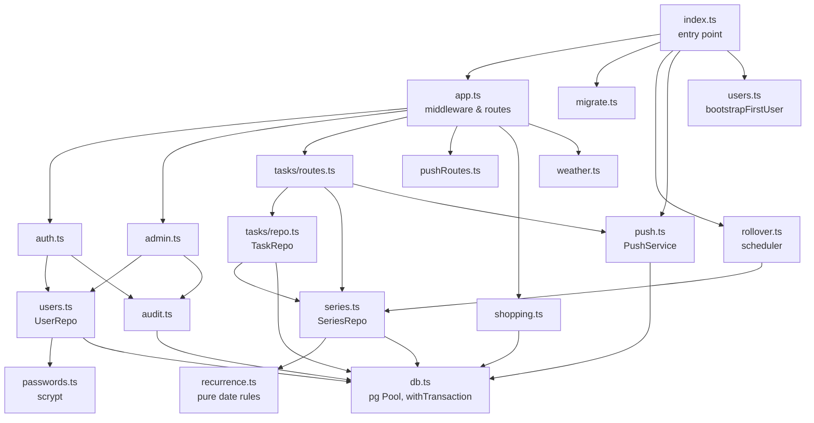
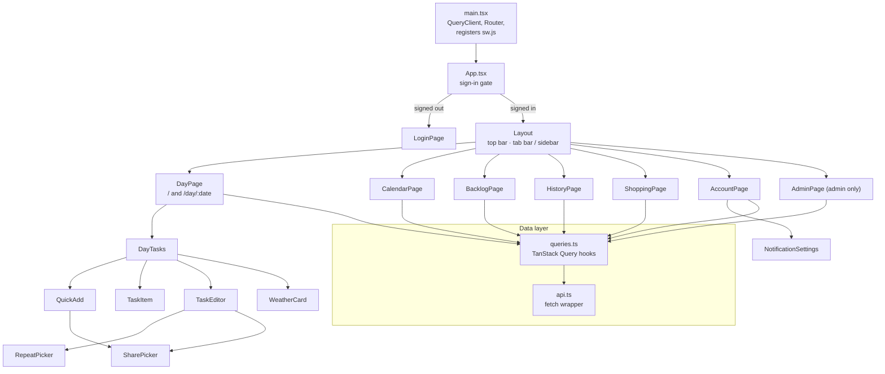

# Architecture

How the pieces fit together at runtime. See also: [Tech stack](tech-stack.md) · [Data model](data-model.md) · [Flows](flows.md)

## System overview

| Box | What runs there |
| --- | --- |
| Web app | All screens; caches server data (TanStack Query); keeps the weather opt-in and rounded location in `localStorage` on this device only |
| Service worker | Shows push notifications and opens the app when one is tapped |
| Server | Static app files, the JSON API, minute jobs (roll-over, repeats, morning summary, shopping clean-up), in-memory weather cache and sign-in throttles; also the `users.js` CLI via `railway ssh` |
| PostgreSQL | All durable data (see [Data model](data-model.md)) |

- **One container** serves both the built SPA and the JSON API from the same origin, so cookies are first-party and there's no CORS.
- **The database is the only durable state.** In-memory state (weather cache, sign-in throttles) is fine to lose on restart.
- **Outbound calls** go only to MET Norway and the four push services.

## Request pipeline

Every `/api` request passes through the same middleware, in this order:

## API map

| Prefix | Who | Endpoints |
| --- | --- | --- |
| `/api/health` | anyone | `GET` database check (Railway health check) |
| `/api/auth` | anyone | `POST login`, `POST logout`, `GET me` |
| `/api/meta` | signed in | `GET` today's date and time zone |
| `/api/users` | signed in | `GET` people you can share with |
| `/api/tasks` | signed in, own/shared tasks only | `GET day/:date`, `GET backlog`, `GET history`, `GET calendar`, `GET :id`, `POST`, `PATCH :id`, `POST :id/complete`, `POST :id/reopen`, `PUT/DELETE :id/repeat`, `DELETE :id` |
| `/api/shopping` | signed in, one shared list | `GET`, `POST`, `POST :id/check`, `POST :id/uncheck`, `DELETE :id` |
| `/api/weather` | signed in | `GET ?lat&lon` |
| `/api/push` | signed in | `GET config`, `POST subscribe`, `POST unsubscribe`, `PATCH prefs`, `POST test` |
| `/api/account` | signed in | `POST password`, `POST signout-others` |
| `/api/admin` | admin | `GET/POST users`, `PATCH users/:id`, `POST users/:id/password`, `POST users/:id/signout`, `GET audit` |

## Server modules

## Client structure

Server data lives in the TanStack Query cache. Mutations invalidate the `['tasks']` (or `['shopping']`, `['push', …]`) keys so every view refreshes; a few (checking off, preference switches) update the cache optimistically first.

## Background jobs

All run inside the web process. "Today" is always the date in `APP_TIMEZONE`.

| Job | Trigger | Does |
| --- | --- | --- |
| Roll-over | Once per new day, checked every minute and before every `/api/tasks` request | Moves open, non-repeating tasks from past days onto today |
| Repeating tasks | Same trigger | Creates occurrences that have come due; rolls over or marks missed per class |
| Morning summary | Every minute | Sends each opted-in user their day's tasks at their chosen time, once a day |
| Shopping clean-up | Every minute, and on each list load | Deletes entries checked off more than 12 hours ago |

Because the jobs live in the web process, the Railway service must stay running (no app sleeping) for summaries to go out on time. The roll-over still catches up on the first request after a wake.
