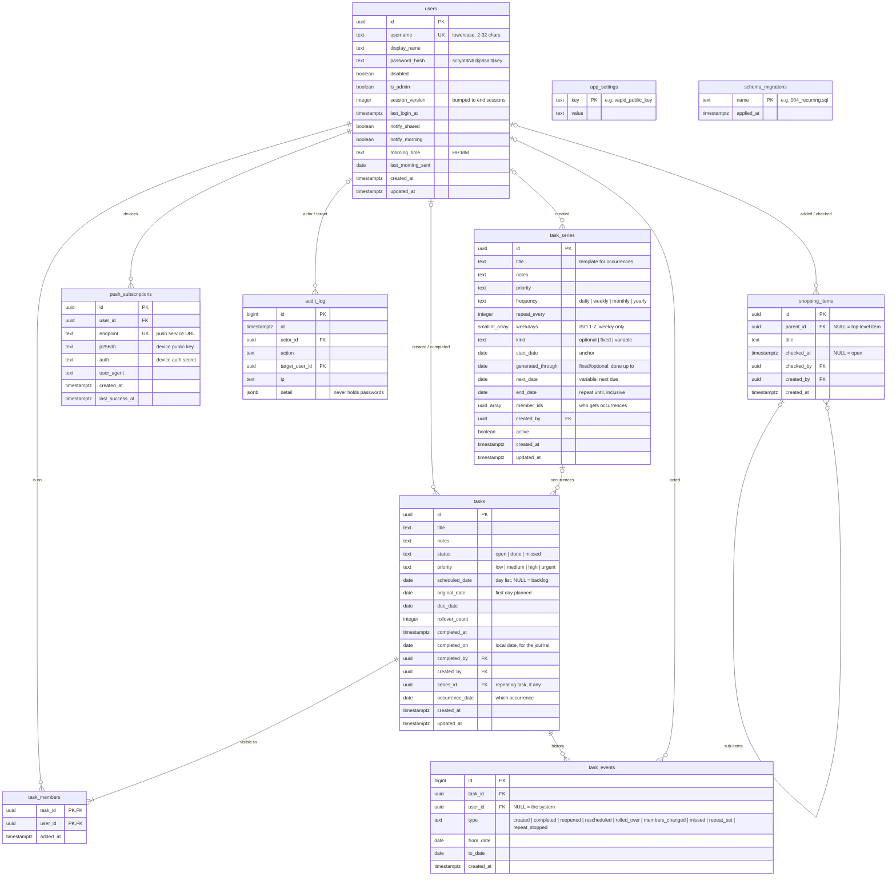

# Data model

All data lives in PostgreSQL. The schema is built by the numbered files in [`server/migrations/`](../server/migrations), applied in order on start and recorded in `schema_migrations`. See also: [Tech stack](tech-stack.md) · [Architecture](architecture.md) · [Flows](flows.md)

## Entity-relationship diagram

## Tables

### `users`
One row per account (a handful, managed by the admin). The first account ever created gets `is_admin`. `session_version` is embedded in every session cookie; incrementing it (password change or reset, disable, "sign out everywhere") invalidates all existing sessions at once. Notification preferences live here too and apply to all of a user's devices.

### `tasks`
Every task, private or shared, one-off or an occurrence of a repeating series.
- **Where it shows:** `status = 'open'` with a `scheduled_date` → that day's list; open with `scheduled_date IS NULL` → backlog; `done` → the day in `completed_on` (journal, history); `missed` → its `scheduled_date`, in a *Missed* section.
- **Roll-over** moves open, non-repeating tasks from past days to today and increments `rollover_count`; `original_date` keeps the first planned day ("↻ since …").
- `completed_on` is the *local* date of completion in `APP_TIMEZONE`, so the journal doesn't depend on the server's clock zone.

### `task_members`
Who can see and work on a task. One member = private; several = shared. **Every task query is filtered through this table** for the signed-in user. Only the creator can delete a shared task; other members can leave by removing themselves.

### `task_events`
Append-only history of what happened to each task and who did it (`user_id` NULL means the server did it, e.g. a roll-over). Used for auditing changes and intended as input for the planned AI review.

### `task_series`
A repeating task's template and rule. Occurrences are ordinary `tasks` rows with `series_id` and `occurrence_date`, created when their day arrives (a unique index on `(series_id, occurrence_date)` prevents duplicates). Future occurrences aren't stored; the API computes previews from the rule.
- `fixed` and `optional` series follow the calendar: `generated_through` records how far occurrences have been created.
- `variable` (flexible) series follow completion: `next_date` is set one period after each completion.
- Editing an occurrence's title, notes, priority or sharing updates the series template and `member_ids`.

### `push_subscriptions`
One row per device that turned on notifications. The endpoint must belong to a known push service. Rows are deleted when the push service reports the device gone (404/410) or the user turns notifications off on that device.

### `audit_log`
Security-relevant events: sign-ins (successful, failed, blocked) and account changes (created, renamed, disabled, password reset, admin granted …), with actor, target and IP. Shown on the Admin page.

### `shopping_items`
The single shared shopping list. `parent_id` makes an entry a sub-item (one level deep, enforced by the API). `checked_at` set = checked off; such entries are deleted 12 hours later. Deleting an item deletes its sub-items (`ON DELETE CASCADE`).

### `app_settings`
Key/value settings owned by the server; today only the generated VAPID key pair for Web Push.

### `schema_migrations`
Which migration files have been applied.

## Rules enforced where

| Rule | Enforced by |
| --- | --- |
| Usernames lowercase `[a-z0-9._-]{2,32}`, unique | `CHECK` + `UNIQUE`, and the API |
| Task status / priority / event types / series kinds are known values | `CHECK` constraints |
| A task is `done` exactly when it has `completed_at` and `completed_on` | `CHECK` constraint |
| A task always has at least one member | API (`memberIds` can't be empty) |
| Users only see tasks they're members of | Every query in `TaskRepo` (`EXISTS … task_members`) |
| One occurrence per series per day | Unique index `(series_id, occurrence_date)` |
| `end_date` not before `start_date` | `CHECK` constraint |
| Shopping sub-items only one level deep | API (`ShoppingRepo.add`) |
| `morning_time` is `HH:MM` | `CHECK` constraint |

## Deleting things

| When this is deleted… | …this happens |
| --- | --- |
| a task | its `task_members` and `task_events` rows are deleted |
| a user (not offered in the app; accounts are disabled instead) | their memberships and devices are deleted; `created_by`, `completed_by`, `checked_by`, audit references become NULL |
| a series | occurrences stay as ordinary tasks (`series_id` → NULL) |
| a shopping item | its sub-items are deleted |
