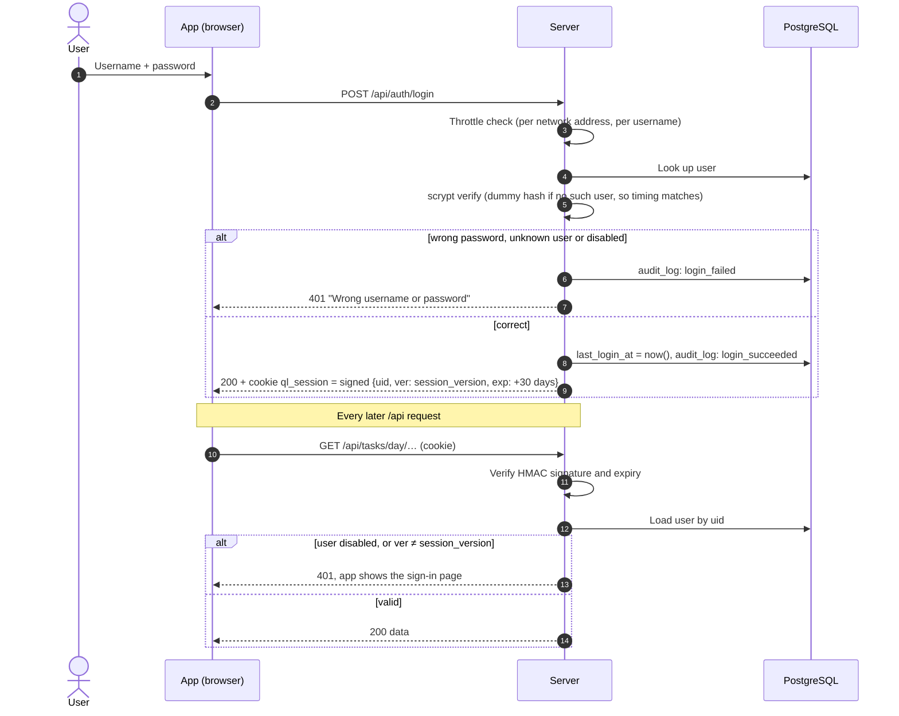
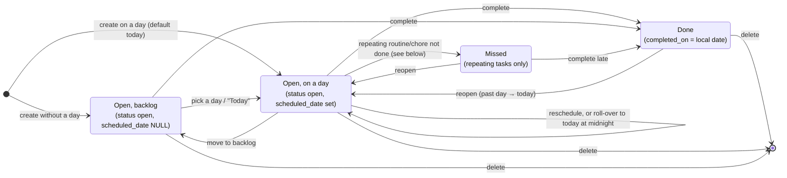
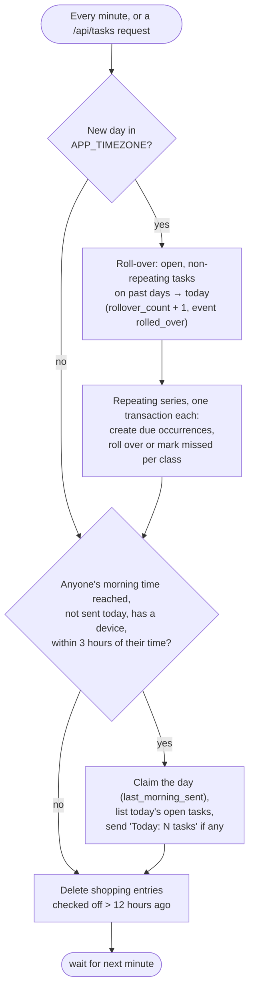
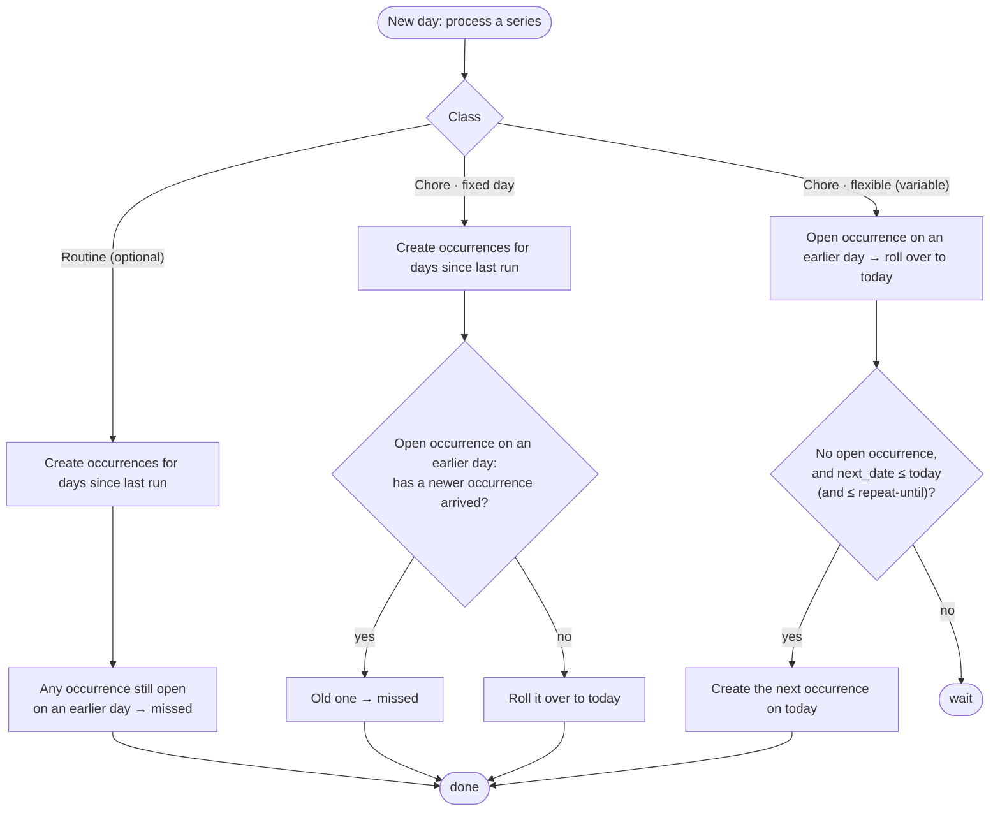
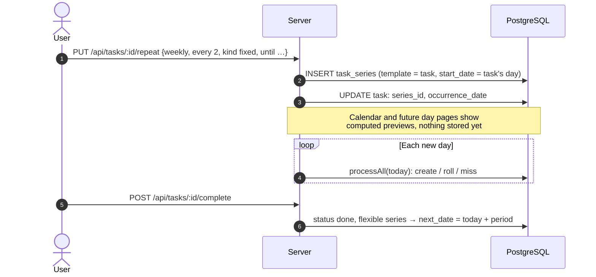
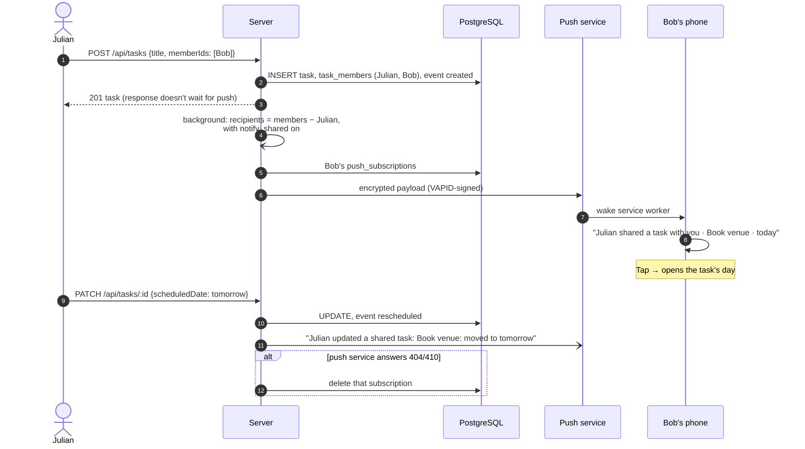
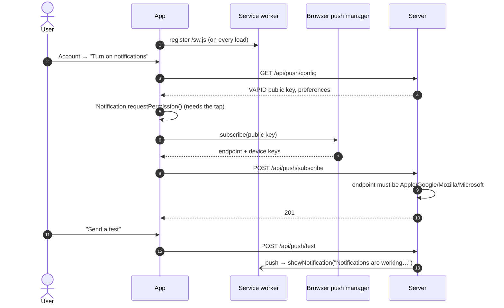
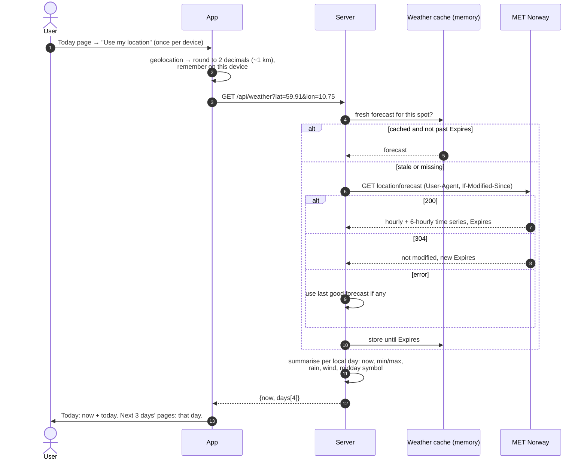
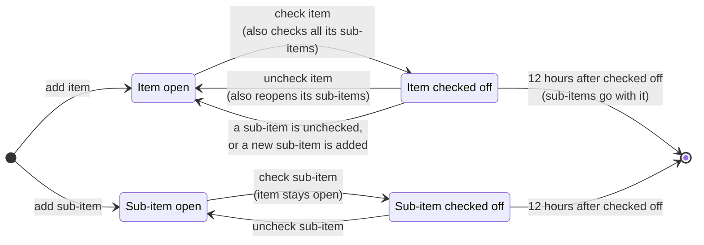
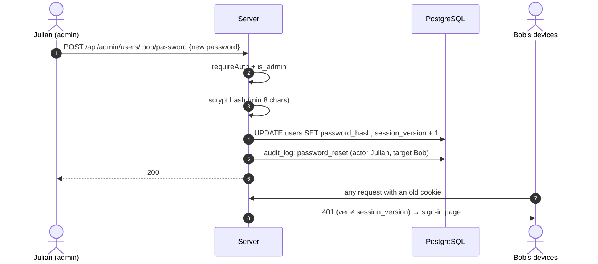

# Flows

How the main things happen, step by step. See also: [Tech stack](tech-stack.md) · [Architecture](architecture.md) · [Data model](data-model.md)

- [Signing in and sessions](#signing-in-and-sessions)
- [A task's life](#a-tasks-life)
- [The daily cycle](#the-daily-cycle)
- [Repeating tasks](#repeating-tasks)
- [Sharing a task and notifying others](#sharing-a-task-and-notifying-others)
- [Turning on notifications](#turning-on-notifications)
- [Weather](#weather)
- [Shopping list](#shopping-list)
- [Admin: resetting a password](#admin-resetting-a-password)

## Signing in and sessions

Changing a password, resetting one, disabling an account or "sign out everywhere" increments `session_version`, which makes every existing cookie for that user invalid on its next request.

## A task's life

Every transition writes a row to `task_events`.

## The daily cycle

The server checks every minute, and before every `/api/tasks` request, whether the date in `APP_TIMEZONE` has changed. The first check on a new day runs the roll-over and repeats; the other jobs run every minute.

## Repeating tasks

A task becomes the first occurrence of a series when you set **Repeat**. On each new day, every active series is processed according to its class:

Completing a flexible occurrence sets `next_date` = completion day + one period (and clears it if that's past the end date), so the whole series shifts. Deleting the open occurrence counts as skipping it.

## Sharing a task and notifying others

Complete, reopen and delete on a shared task notify the other members the same way. The person making the change is never notified, and edits that change nothing send nothing.

## Turning on notifications

On iPhone and iPad this only works from the Home Screen app (iOS 16.4+); in a Safari tab the Account page explains how to add it.

## Weather

Coordinates are never stored on the server.

## Shopping list

One list shared by everyone. Rules for items and sub-items:

An item is only checked off when someone checks it itself, even if all its sub-items are done; it then shows "N of N checked off". The page polls every 15 seconds so other people's changes appear.

## Admin: resetting a password

Disabling, "sign out everywhere" and the `users.js` CLI commands follow the same pattern; the CLI writes its audit entries with no actor (`via: cli`).
