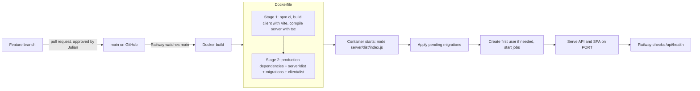

# Tech stack

Questlog is a TypeScript monorepo: a React single-page app and an Express API, deployed together as one container on Railway with a PostgreSQL database.

See also: [Architecture](architecture.md) · [Data model](data-model.md) · [Flows](flows.md)

## At a glance

| Layer | Technology | Version | Why |
| --- | --- | --- | --- |
| Language | TypeScript | 7.0 | One language end to end; types shared in spirit between client and server |
| Runtime | Node.js | 22 (Alpine image) | Runs the API, the CLI tools and the build |
| Web framework | Express | 5.3 | Small, familiar; v5 forwards async errors to the error handler |
| Validation | zod | 4.6 | Every request body, query and parameter is parsed, not trusted |
| Database driver | pg (node-postgres) | 8.23 | Plain SQL with parameters; no ORM |
| Database | PostgreSQL | 16 (Railway) | Relational data, transactions, row locks for the daily jobs |
| Security headers | helmet | 8.3 | CSP, HSTS, no-sniff and friends |
| Cookies | cookie-parser | 1.4 | Reads the signed session cookie |
| Push | web-push | 3.6.7 (pinned) | VAPID signing and payload encryption for Web Push |
| UI library | React | 19.3 | Component model for the SPA |
| Routing | React Router | 8.5 | Client-side pages (`/`, `/day/:date`, `/calendar`, …) |
| Server state | TanStack Query | 5.105 | Caching, refetching, optimistic updates |
| Bundler / dev server | Vite | 8.3 | Fast dev server with `/api` proxy; production bundle |
| Tests | Vitest + Supertest | 5.1 / 7.3 | Unit tests and HTTP-level API tests against a real Postgres |
| Dev tooling | tsx, concurrently | 4.23 / 10.0 | Run TypeScript directly; start API and client together |
| Hosting | Railway | n/a | Builds the `Dockerfile`, runs the container, hosts Postgres |

Not used on purpose: no ORM (the SQL is short and explicit), no CSS framework (one hand-written `styles.css` with CSS variables), no state library beyond TanStack Query, no auth provider (a handful of accounts managed by the admin).

## External services

| Service | Used for | Notes |
| --- | --- | --- |
| [MET Norway Locationforecast 2.0](https://api.met.no/weatherapi/locationforecast/2.0/documentation) | Weather on the day pages | Data behind yr.no. Free; requires an identifying `User-Agent`, caching per `Expires`, and attribution. Called only from the server. |
| Web Push services (Apple, Google FCM, Mozilla, Microsoft WNS) | Delivering notifications to devices | The server only sends to these hosts. |

## Repository layout

```
questlog/
├── client/                  React SPA (Vite)
│   ├── public/              sw.js (service worker), manifest, icons
│   └── src/
│       ├── pages/           One file per route (Day, Calendar, Backlog, History, Shopping, Account, Admin, Login)
│       ├── components/      Task list/editor, repeat & share pickers, weather card, notification settings, layout
│       ├── api.ts           Typed fetch wrapper for every /api endpoint
│       ├── queries.ts       TanStack Query hooks
│       └── styles.css       All styles (light/dark via CSS variables)
├── server/
│   ├── migrations/          Numbered SQL files, applied in order on start
│   ├── src/
│   │   ├── index.ts         Entry point: config, migrations, jobs, HTTP server
│   │   ├── app.ts           Express app: middleware and route wiring
│   │   ├── tasks/           Task repository (SQL) and routes
│   │   ├── series.ts        Repeating tasks: generation, roll-over, missed
│   │   ├── recurrence.ts    Pure date rules for repeats
│   │   ├── rollover.ts      Daily roll-over and its scheduler
│   │   ├── auth.ts          Sessions, sign-in throttling, origin check, account routes
│   │   ├── admin.ts         Admin API
│   │   ├── users.ts         Accounts, passwords, first-user bootstrap
│   │   ├── push.ts          Web Push: subscriptions, sending, morning summary
│   │   ├── weather.ts       MET Norway client, caching, daily summary
│   │   ├── shopping.ts      Shared shopping list
│   │   ├── audit.ts         Audit log
│   │   └── cli/users.ts     Command-line account management
│   └── test/                Vitest suites (unit + API)
├── docs/                    This documentation
├── Dockerfile               Multi-stage build: build both, ship server + client/dist
└── railway.json             Railway build/deploy settings, health check
```

## Build and deploy



## Configuration

All configuration is environment variables on the Railway service; see the table in the [README](../README.md#deploying-to-railway). Required: `DATABASE_URL`, `SESSION_SECRET`. Usually set: `APP_TIMEZONE`. Optional: `WEATHER_USER_AGENT`, `VAPID_SUBJECT`, `VAPID_PUBLIC_KEY`/`VAPID_PRIVATE_KEY`, and `ADMIN_USERNAME`/`APP_PASSWORD` (only for the one-time upgrade to multi-user).
